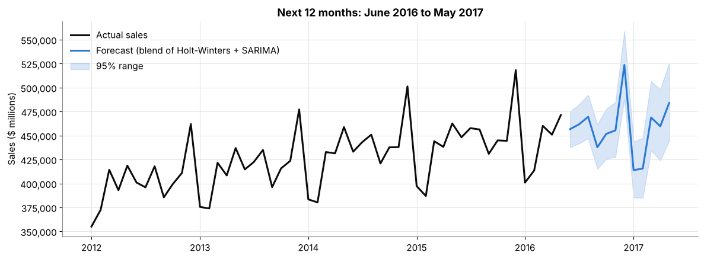
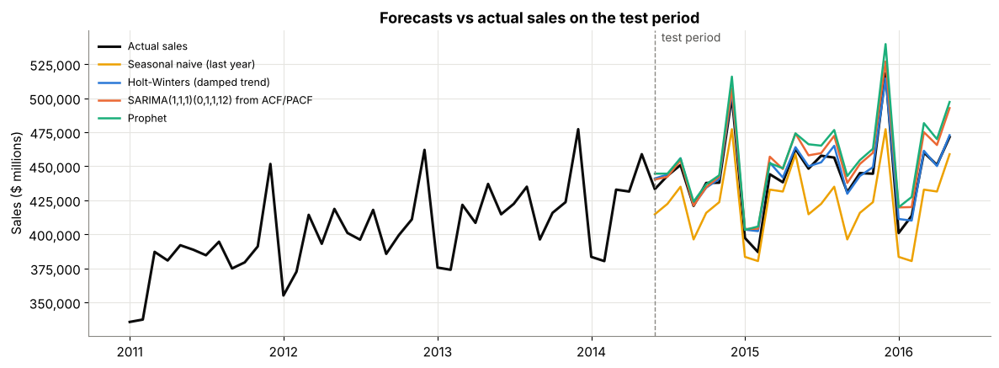

# Sales Forecasting

Forecasting US monthly retail sales for the next 12 months with time series models.

## Result
The final model (a blend of damped Holt-Winters + SARIMA) was off by **1.4% per month** on the last 24 months it never saw (MAE $6,234 million). The simple "same as last year" rule was off by 4.7%. It forecasts **1.9% sales growth** for June 2016 to May 2017.



## Problem
Shops need to know future sales to plan stock, staff and cash. The goal: predict total monthly retail sales 12 months ahead, and give a range, not just one number.

## Dataset
US monthly retail sales from the US Census Bureau, January 1992 to May 2016 (293 months, in millions of US dollars). The copy used here comes from the [Prophet examples folder](https://github.com/facebook/prophet/blob/main/examples/example_retail_sales.csv). It is free and needs no login.

## Steps
1. **Missing dates:** checked every month exists with `pd.date_range` + left join. None were missing. Practised filling gaps with ffill, bfill and interpolate on a copy (interpolate was closest).
2. **Explore:** found a rising **trend**, strong yearly **seasonality** (December about 15-20% above an average month), a **cycle** (the 2008-09 recession) and small **noise**. Seasonal swings grow with sales, so used log / multiplicative models.
3. **Decomposition:** split the series into trend, seasonality and noise.
4. **Outliers:** IQR rule on the noise part, done by hand and with the ADTK library (`InterQuartileRangeAD`). Both found the same 4 months: Dec 2008 (recession), Feb 2000 and Feb 2012 (leap years, 29 days), Dec 1992. Kept them, because they are real events.
5. **Stationarity:** Lag and difference tables, then the ADF test. Raw and log sales were not stationary (p = 0.86, 0.45). After one difference + one seasonal difference, p = 0.00. So d = 1, D = 1.
6. **ACF / PACF:** used to pick SARIMA(1,1,1)(0,1,1,12). Also ran a small AIC grid search.
7. **Split by time:** train Jan 1992 to May 2014, test the last 24 months (never shuffled).
8. **Models:** naive, seasonal naive, AR, ARIMA, simple exponential smoothing, Holt, Holt-Winters, damped Holt-Winters, SARIMA (2 versions), Prophet, Darts Exponential Smoothing, and a blend.
9. **Metrics:** MAE, RMSE, MAPE.
10. **Time-series cross-validation:** 5 expanding-window folds, each predicting 12 months (2009 to 2014).
11. **Residual check:** error plots, ACF of errors, Ljung-Box test.
12. **Final forecast:** retrained on all data, forecast 12 months with a 95% range.

## Model Comparison (test set: Jun 2014 to May 2016)
| Model | MAE ($M) | RMSE ($M) | MAPE |
|---|---|---|---|
| Holt-Winters (damped trend) | 4,296 | 5,580 | 1.00% |
| Darts Exp. Smoothing (damped) | 4,296 | 5,580 | 1.00% |
| Holt-Winters | 5,591 | 7,023 | 1.29% |
| **Blend: HW damped + SARIMA (final)** | **6,234** | **7,603** | **1.43%** |
| SARIMA(1,1,1)(0,1,1,12) from ACF/PACF | 9,335 | 10,989 | 2.12% |
| Prophet | 12,605 | 14,370 | 2.83% |
| AR(2) + trend + months | 14,350 | 15,515 | 3.21% |
| SARIMA(2,1,2)(0,1,1,12) lowest AIC | 15,213 | 16,641 | 3.43% |
| Holt (trend only) | 19,626 | 28,288 | 4.44% |
| Seasonal naive (same month last year) | 21,197 | 23,298 | 4.75% |
| Naive (last value) | 24,957 | 32,377 | 5.78% |
| Simple Exponential Smoothing | 26,681 | 33,468 | 5.86% |
| ARIMA(2,1,2) (no seasonality) | 28,357 | 34,720 | 6.23% |

## Cross-validation (average MAPE over 5 years)
| Model | Avg MAPE | Worst year |
|---|---|---|
| SARIMA(1,1,1)(0,1,1,12) | 2.62% | 5.1% |
| SARIMA lowest AIC | 2.63% | 5.5% |
| **Blend (final)** | **3.29%** | **8.0%** |
| Holt-Winters (damped) | 4.03% | 11.0% |
| Holt-Winters | 4.25% | 13.8% |
| Seasonal naive | 5.05% | 6.6% |
| Prophet | 5.83% | 9.4% |

**Why the blend?** Holt-Winters was best on the test set but failed badly in 2009-10 (it treated the recession drop as the new trend). SARIMA was the most stable in cross-validation. The blend was 2nd best on the test and protects against one model going wrong.



## Key Learnings
- **Seasonality is everything here.** Every model without seasonality did worse than just copying last year.
- **Always build a naive baseline.** Seasonal naive (4.7%) gave a fair score to beat.
- **One test split can fool you.** Holt-Winters won the test, but cross-validation showed a bad year after the recession.
- **Lowest AIC is not the best forecast.** The SARIMA picked from ACF/PACF beat the lowest-AIC SARIMA on new data.
- **A little pattern is left in the errors** (Ljung-Box p < 0.05), probably calendar effects (number of weekends, leap-year Februaries, Easter). Next step: add these as extra inputs.

## Business Takeaways
- December is the peak month; January and February are the weakest. Plan stock and staff around this.
- A 1-3% monthly error is good enough for stock and budget planning.
- Shocks like a recession can't be seen in past sales. Use the 95% range and retrain every month.

## Files
- `sales_forecasting.ipynb`: the full notebook with outputs
- `us_retail_sales.csv`: the data
- `*.png`: the charts
- `requirements.txt`: libraries needed

## How to Run
```
pip install -r requirements.txt
jupyter lab
```
Then open `sales_forecasting.ipynb` and run all cells.

**Windows / Anaconda note for Prophet:** if `pip install prophet` fails, open Anaconda Prompt and run:
```
conda install -c conda-forge prophet
```
If Prophet still fails, every other model in the notebook works without it. Just skip the Prophet cells.

**Darts:** `pip install u8darts` installs the light version (no deep learning parts), which is all this notebook needs. **ADTK:** `pip install adtk`.

## Tools
Python, pandas, numpy, matplotlib, seaborn, statsmodels (ADF, ACF/PACF, AR, ARIMA, SARIMA, Holt-Winters, ETS), Prophet, Darts, ADTK, Jupyter
